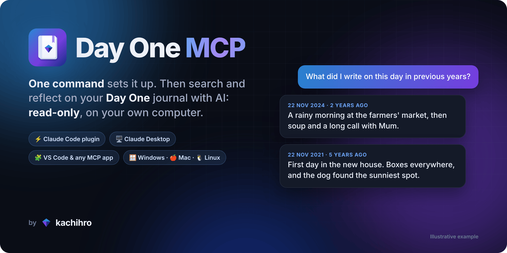
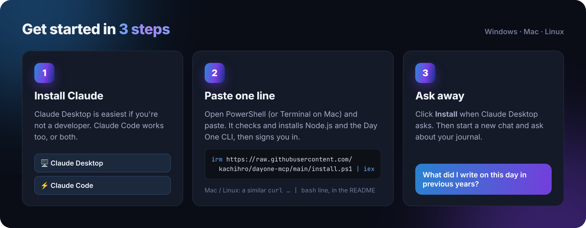
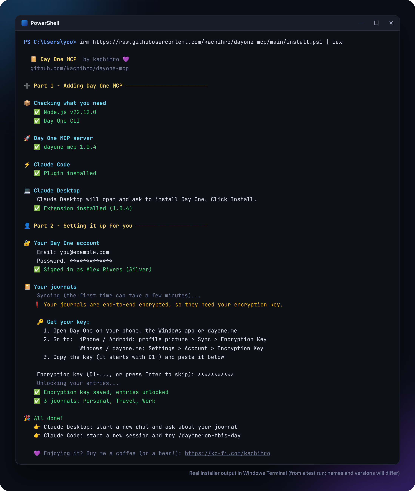
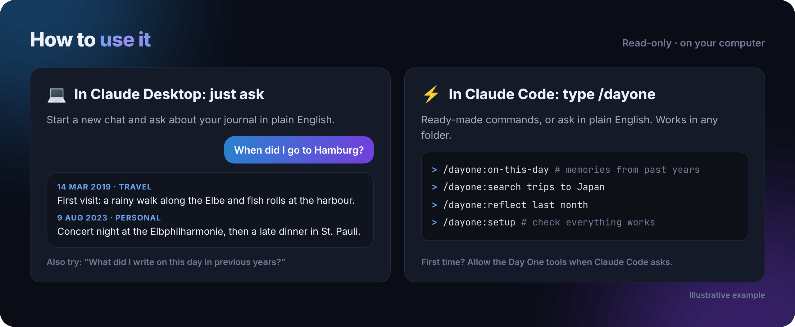

<p align="center">
  <picture>
    <source media="(prefers-color-scheme: light)" srcset="docs/images/hero-light.png">
    
  </picture>
</p>

<p align="center">
  <a href="https://github.com/kachihro/dayone-mcp/actions/workflows/ci.yml"></a>
  <a href="https://github.com/kachihro/dayone-mcp/releases/latest"></a>
  <a href="LICENSE"></a>
  <a href="https://www.kachihro.com"></a>
  <a href="https://ko-fi.com/kachihro"></a>
</p>

<h3 align="center">One command. Then read-only access to query your Day One journals with AI.</h3>

**The one command:**

- 📦 Installs **Node.js**, if needed
- 📦 Installs the official **Day One CLI**, if needed
- 🔐 Signs you in with your Day One **email**, **password** and **encryption key** (if your journals are encrypted)
- 🚀 Connects **Claude Code** and **Claude Desktop**, then you just ask

Free and open source, from [**kachihro**](https://www.kachihro.com).

> 🔒 **Currently read-only.** Day One MCP can **search and read** your journal, but it can't create,
> change or delete anything. Your journal stays exactly as you wrote it, and everything runs **on your
> own computer**.
>
> ✍️ **Would you like Claude to add entries to your journal?** It's possible with the Day One CLI, and I'll
> add it as an option if people want it. [Let me know here](https://github.com/kachihro/dayone-mcp/issues/new?title=Add+to+journal+please&body=I%27d+like+Claude+to+be+able+to+add+entries.)
> or give the issue a 👍.

---

## 🚀 Install

<p align="center">
  <picture>
    <source media="(prefers-color-scheme: light)" srcset="docs/images/steps-light.png">
    
  </picture>
</p>

**1. Have Claude ready.** Install [Claude Desktop](https://claude.ai/download) (easiest if you're not a
developer) or Claude Code first. The installer connects whichever ones it finds.

**2. Paste one line.**

**🪟 Windows:** press the **Windows key**, type `PowerShell`, press **Enter**, then paste this (right-click
pastes) and press **Enter**:

```powershell
irm https://raw.githubusercontent.com/kachihro/dayone-mcp/main/install.ps1 | iex
```

**🍎 Mac / 🐧 Linux:** open **Terminal** (Mac: **Cmd+Space**, type `Terminal`, **Enter**), paste this and
press **Enter**:

```bash
curl -fsSL https://raw.githubusercontent.com/kachihro/dayone-mcp/main/install.sh | bash
```

**3. Answer a few questions.** The installer does the rest:

| | What it does |
|---|---|
| 📦 **Checks what you need** | Installs the official **Day One CLI**, and offers to install **Node.js** if it's missing or too old |
| 🚀 **Adds Day One MCP** | Downloads the server, installs the **Claude Code plugin**, and the **Claude Desktop extension** (just click **Install** when Claude Desktop asks) |
| 🔐 **Signs you in** | Your Day One **email** and **password** (it shows `*`, and pasting works). They go straight to the Day One CLI and are never shown, saved, or seen by the AI |
| 🔑 **Unlocks encrypted journals** | If your journals are end-to-end encrypted, it shows where to find your key and checks it works |
| 📔 **Downloads your journals** | With a live progress count, then lists them |

<details>
<summary>🔑 <b>Where's my encryption key?</b></summary>
<br>

1. Open Day One on your phone, your computer or [dayone.me](https://dayone.me).
2. Go to:
   - **iPhone / Android:** profile picture → **Sync** → **Encryption Key**
   - **Mac:** **Settings** → **Sync** → **Advanced** → **View Encryption Key**
   - **Windows / dayone.me:** **Settings** → **Account** → **Encryption Key**
3. Copy the key (it starts with `D1-`) and paste it into the installer.

Day One's guide if it's lost: [Finding a lost encryption key](https://dayoneapp.com/guides/troubleshooting/finding-a-lost-encryption-key/).

</details>

<details>
<summary>👀 <b>See what the installer looks like</b></summary>
<br>

</details>

**4. That's it!** 🎉 Start a new chat (Claude Desktop) or a new session (Claude Code) and ask about your
journal.

---

## 💬 How to use

<p align="center">
  <picture>
    <source media="(prefers-color-scheme: light)" srcset="docs/images/how-to-use-light.png">
    
  </picture>
</p>

### 💻 In Claude Desktop: just ask

Start a **new chat** and ask in plain English:

- *"What did I write on this day in previous years?"*
- *"When did I go to Hamburg?"*
- *"How was I feeling in the weeks before the move?"*
- *"Summarise my travel journal from 2024."*

### ⚡ In Claude Code: type `/dayone`

| Type this | What you get |
|---|---|
| `/dayone:on-this-day` | Your entries from today in past years. Add a date: `/dayone:on-this-day Christmas` |
| `/dayone:search <topic>` | Searches with related words and summarises, e.g. `/dayone:search trips to Japan` |
| `/dayone:reflect <period>` | Highlights, themes and mood, e.g. `/dayone:reflect last month` |
| `/dayone:setup` | Checks everything works and tells you what to fix |

Or just ask in plain English. The first time, Claude Code asks permission to use the Day One tools:
choose **Yes, and don't ask again**.

> 💡 **Tips:** Wrote something new? Ask Claude to *"sync my journal"* first. On Windows and Intel Macs,
> search matches your words exactly, so try a few related words (`/dayone:search` does this for you).

---

## 📋 Commands at a glance

<details open>
<summary><b>🪟 Windows</b> (PowerShell)</summary>

**Install, or update to the latest version**
```powershell
irm https://raw.githubusercontent.com/kachihro/dayone-mcp/main/install.ps1 | iex
```
**Sign in, add your encryption key, switch account, or re-sync**
```powershell
irm https://raw.githubusercontent.com/kachihro/dayone-mcp/main/configure.ps1 | iex
```
**Uninstall** (then asks whether to also remove the Day One CLI, for a fresh start)
```powershell
irm https://raw.githubusercontent.com/kachihro/dayone-mcp/main/uninstall.ps1 | iex
```

</details>

<details open>
<summary><b>🍎 Mac / 🐧 Linux</b> (Terminal)</summary>

**Install, or update to the latest version**
```bash
curl -fsSL https://raw.githubusercontent.com/kachihro/dayone-mcp/main/install.sh | bash
```
**Sign in, add your encryption key, switch account, or re-sync**
```bash
curl -fsSL https://raw.githubusercontent.com/kachihro/dayone-mcp/main/configure.sh | bash
```
**Uninstall** (then asks whether to also remove the Day One CLI, for a fresh start)
```bash
curl -fsSL https://raw.githubusercontent.com/kachihro/dayone-mcp/main/uninstall.sh | bash
```

</details>

**Day One CLI extras** (in PowerShell or Terminal): `dayone sync` downloads your latest entries now ·
`dayone sync-schedule enable --interval-minutes 30` keeps them up to date automatically ·
`dayone list journals` lists your journals.

---

## ❓ FAQs

<details>
<summary><b>Is it really read-only?</b></summary>
<br>

Yes. Day One MCP only has tools to **search, list and read** entries, plus one to download your latest
entries from Day One. There are no tools to create, edit or delete anything, so the AI can't change your
journal even if asked to.

Adding entries could come later as an **opt-in** choice in the installer (off unless you say yes), if
people want it. [Let me know](https://github.com/kachihro/dayone-mcp/issues/new?title=Add+to+journal+please&body=I%27d+like+Claude+to+be+able+to+add+entries.)
if you would.

</details>

<details>
<summary><b>What does the installer change on my computer?</b></summary>
<br>

- **Node.js:** only if it's missing or older than version 18, and only if you say yes.
- **The Day One CLI:** Day One's official command-line tool (`@dayone/cli`, installed with npm).
- **Day One MCP:** one program in `%LOCALAPPDATA%\Programs\dayone-mcp` (Windows) or
  `~/.local/share/dayone-mcp` (Mac/Linux).
- **Claude Code:** the Day One plugin. **Claude Desktop (Windows):** the Day One extension.
  **Claude Desktop (Mac):** one `dayone` entry in its settings file (a backup is kept).

Uninstall removes all of it (see [Commands at a glance](#-commands-at-a-glance)).

</details>

<details>
<summary><b>Which AI apps does it work with?</b></summary>
<br>

**Claude Desktop** and **Claude Code** are set up automatically. It also works with **VS Code (GitHub
Copilot)**, **Cursor** and any other app that supports MCP: see [Connect another app](docs/manual-setup.md#connect-another-app).

</details>

<details>
<summary><b>Does my journal leave my computer?</b></summary>
<br>

Day One MCP runs on your computer, has no servers, and collects no data. Your Day One password only ever
goes to the Day One CLI. The entries the AI reads to answer a question are sent to your AI provider (for
example Anthropic), like anything else you share in a chat, so you choose what to ask about.

</details>

<details>
<summary><b>Why do the <code>/dayone:</code> commands not work in Claude Desktop?</b></summary>
<br>

They're Claude Code commands. In Claude Desktop, just ask in plain English in a new chat, for example
*"When did I go to Hamburg?"*.

</details>

<details>
<summary><b>Why does Claude Desktop say "Unknown developer"?</b></summary>
<br>

Claude Desktop says that for any extension that isn't code-signed with a paid certificate, which is
normal for free, open-source extensions. It doesn't mean anything's wrong. Day One MCP is
[open source](src/DayOneMcp), read-only, and built and published by GitHub Actions from this repository,
with checksums for every download.

</details>

<details>
<summary><b>Is this an official Day One product?</b></summary>
<br>

No, it's an independent community project by [kachihro](https://www.kachihro.com). It uses Day One's
official, public [Day One CLI](https://github.com/Automattic/DayOne-Cli) and no private APIs. On a Mac,
Day One also has its own [built-in MCP server](https://dayoneapp.com/guides/day-one-for-mac/day-one-mcp-server/):
see [Other options](#other-options).

</details>

<details>
<summary><b>Something's not working. What should I do?</b></summary>
<br>

1. Run the installer again. It's safe to re-run, and it fixes most things (it skips what's already done).
2. In Claude Code, run `/dayone:setup`. It checks each piece and tells you what to fix.
3. See the full [troubleshooting guide](docs/troubleshooting.md), or
   [open an issue](https://github.com/kachihro/dayone-mcp/issues/new/choose). Please don't include journal text or passwords.

</details>

---

## 🔒 Privacy and how it works

<p align="center">
  <picture>
    <source media="(prefers-color-scheme: light)" srcset="docs/images/how-it-works-light.png">
    
  </picture>
</p>

[MCP](https://modelcontextprotocol.io) is the standard way AI apps connect to tools. Day One MCP reads
the copy of your journals that the official Day One CLI keeps on your computer. It turns off the CLI's
optional telemetry, and it never sees your password.

---

## Other options

Day One MCP is one way to use your journal with AI. Day One also offers:

- **Day One's built-in MCP server (Mac only).** Built into Day One for Mac: turn it on in **Preferences →
  Labs → MCP Access Control** (Silver or Gold plan). It can also **create and update** entries.
  See Day One's guide: [Day One MCP Server](https://dayoneapp.com/guides/day-one-for-mac/day-one-mcp-server/).
- **The Day One CLI on its own.** Day One's official
  [command-line tool](https://github.com/Automattic/DayOne-Cli) works in a terminal on Windows, Mac and
  Linux, and Claude Code can run it directly. It can also write entries.

| You want | Best fit |
|---|---|
| Windows or Linux | **Day One MCP** |
| `/dayone:` commands in Claude Code | **Day One MCP** |
| VS Code (GitHub Copilot), Cursor or another MCP app | **Day One MCP** |
| Read-only, so nothing in your journal can change | **Day One MCP** |
| Claude to create or edit entries, on a Mac | Day One's built-in MCP server |

---

## More

- 🛠️ **[Manual setup](docs/manual-setup.md):** set things up by hand, or connect VS Code, Cursor and other apps.
- 🩺 **[Troubleshooting](docs/troubleshooting.md):** fixes for every message you might see.
- 👩‍💻 **For developers:** C# / .NET 10 on the official [MCP C# SDK](https://github.com/modelcontextprotocol/csharp-sdk).
  Building, testing and releasing are in [CONTRIBUTING.md](CONTRIBUTING.md). Contributions are very welcome! 💛

## Support the project ☕🍺

Day One MCP is free and built in personal development time. If it helps you get more out of your
journal, a small tip helps cover the time that goes into it, and maybe a few coffees (or a beer! 🍺). 💜

<p>
  <a href="https://ko-fi.com/kachihro"></a>
</p>

Starring the repo ⭐, sharing it with other Day One fans, and [reporting bugs](https://github.com/kachihro/dayone-mcp/issues/new/choose) help too.

**More free tools from kachihro:** [Waffle-Assist](https://www.waffle-assist.com), a smarter Microsoft 365
app launcher, and [SPO-Assist](https://www.spo-assist.com), quick actions for SharePoint Online. See them
all at [kachihro.com/freebies](https://www.kachihro.com/freebies/). Need help with Microsoft 365, SharePoint
or Azure development? [kachihro can help](https://www.kachihro.com).

## Disclaimer

This is an independent community project. It is **not affiliated with or endorsed by Day One or
Automattic**. "Day One" is a trademark of its owner. It uses the official, publicly available
[Day One CLI](https://github.com/Automattic/DayOne-Cli) and doesn't use any private APIs.

## Licence

[MIT](LICENSE). The README images use the [Inter](https://rsms.me/inter/) and
[JetBrains Mono](https://www.jetbrains.com/lp/mono/) fonts (SIL Open Font Licence).

---

<p align="center">
  <a href="https://www.kachihro.com"></a><br>
  <sub>Made with 💜 by <a href="https://www.kachihro.com"><b>kachihro</b></a>, Microsoft 365, SharePoint and Azure development
  · <a href="https://ko-fi.com/kachihro">Buy me a coffee (or a beer! 🍺)</a></sub>
</p>
