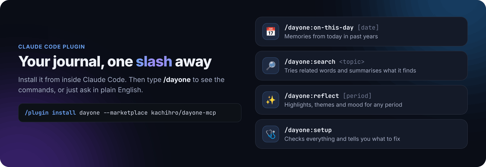

<p align="center">
  
</p>

<p align="center">
  <a href="https://github.com/kachihro/dayone-mcp/actions/workflows/ci.yml"></a>
  <a href="https://github.com/kachihro/dayone-mcp/releases/latest"></a>
  <a href="LICENSE"></a>
  <a href="https://www.kachihro.com"></a>
  <a href="https://ko-fi.com/kachihro"></a>
</p>

<p align="center">
  Free and open source, from <a href="https://www.kachihro.com"><b>kachihro</b></a>, the makers of
  <a href="https://www.waffle-assist.com">Waffle-Assist</a> and <a href="https://www.spo-assist.com">SPO-Assist</a>.
</p>

---

Ask things like:

- *"What did I write on this day in previous years?"*
- *"Find my entries about the beach from last summer. How was I feeling?"*
- *"When did I last mention Mum's birthday?"*
- *"Reflect on my journal from last month."*

**How it works, in one line:** [MCP](https://modelcontextprotocol.io) is the standard way AI apps
connect to tools. This project is an MCP tool that reads your journal through the
[Day One CLI](https://github.com/Automattic/DayOne-Cli), Day One's official command-line program.
It's **read-only** (it can't change or delete anything) and runs **on your own computer**.

> **On a Mac?** Day One has its own built-in MCP server (Preferences → Labs), which you may prefer.
> Use this project if you're on Windows or Linux, or want the Claude Code commands below.

---

## Quick start

<p align="center"></p>

**1. Install the Claude app you want to use first**: [Claude Desktop](https://claude.ai/download)
(easiest if you're not a developer) or Claude Code. The installer connects whichever ones it finds.
If you install another one later, just run the installer again.

**2. Run the installer.** It sets up everything: Node.js, the Day One CLI, your Day One sign-in,
this server, and the connection to Claude.

<details open>
<summary><b>Windows</b></summary>

Open **PowerShell**: press the **Windows key**, type `PowerShell`, and press **Enter**. Paste this
line (right-click pastes), then press **Enter**. You don't need to run it as administrator.

```powershell
irm https://raw.githubusercontent.com/kachihro/dayone-mcp/main/install.ps1 | iex
```

</details>

<details open>
<summary><b>macOS / Linux</b></summary>

Open **Terminal** (Mac: press **Cmd+Space**, type `Terminal`, press **Enter**), paste this line,
then press **Enter**:

```bash
curl -fsSL https://raw.githubusercontent.com/kachihro/dayone-mcp/main/install.sh | bash
```

</details>

<details>
<summary>👀 See what the installer looks like</summary>
<br>

</details>

The installer asks a few yes/no questions. It then runs Day One's own sign-in, where you type your
Day One email and password. The AI never sees them. If your journals use end-to-end encryption,
also run `dayone auth key-set` afterwards with your encryption key (see [Troubleshooting](#troubleshooting)
for where to find it).

**3. Restart Claude.**
- **Claude Desktop:** fully quit it (Windows: right-click its icon near the clock → **Quit**; Mac: **Cmd+Q**), then reopen it.
- **Claude Code:** start a new session.

Then ask *"What did I write on this day in previous years?"* 🎉

Prefer to set things up yourself, or using VS Code or another app? Read on.

---

## Set up the Day One CLI (manual setup only)

The installer does this for you. Everything else in this guide needs it.

1. Install [Node.js](https://nodejs.org) LTS, version 18 or newer. The Day One CLI needs it. On
   Windows you can run `winget install OpenJS.NodeJS.LTS`, then **close and reopen PowerShell**.
2. In PowerShell (Windows) or Terminal (Mac/Linux), run these one at a time:
   ```
   npm install -g @dayone/cli@latest
   dayone setup
   dayone sync
   ```
   `dayone setup` asks for your Day One email and password. `dayone sync` downloads your journals
   to your computer, and the first sync can take a few minutes.
3. If your journals use **end-to-end encryption**, also run `dayone auth key-set`.
4. Check it worked: `dayone list journals` should list your journals.

---

## Option 1: Claude Code plugin

**Best for Claude Code users.** It adds ready-made commands as well as the journal tools.

<p align="center"></p>

> **Used the installer?** It already installed the plugin. Start a new session and run `/dayone:setup`.

1. [Set up the Day One CLI](#set-up-the-day-one-cli-manual-setup-only).
2. In Claude Code, run:
   ```
   /plugin install dayone --marketplace kachihro/dayone-mcp
   ```
   <sub>On Claude Code older than 2.1.275 (check with `claude --version`), run
   `/plugin marketplace add kachihro/dayone-mcp` and then `/plugin install dayone@dayone-mcp` instead.</sub>
3. Start a new session and run **`/dayone:setup`** to check everything's working.

The first time it starts, the plugin downloads its server (about 40 MB) and verifies the download.

| Command | What it does |
|---|---|
| `/dayone:on-this-day [date]` | Your memories from today (or any date) in past years |
| `/dayone:search <topic>` | Searches with several related words and summarises what it finds |
| `/dayone:reflect [period]` | Highlights, themes and mood, e.g. `/dayone:reflect last month` |
| `/dayone:setup` | Checks each piece and tells you what to fix |

You can also just ask in plain English. The plugin teaches Claude how to search a journal well.

---

## Option 2: MCP server

**For Claude Desktop, VS Code (GitHub Copilot), Cursor, or any app that supports MCP.**

### Step 1: Get the server

**Easiest:** run the [installer](#quick-start). It works even if you don't use Claude (it skips the
Claude steps). It puts the server here:

| | Server location |
|---|---|
| Windows | `%LOCALAPPDATA%\Programs\dayone-mcp\DayOneMcp.exe` (that's `C:\Users\<you>\AppData\Local\Programs\dayone-mcp\DayOneMcp.exe`) |
| macOS / Linux | `~/.local/share/dayone-mcp/DayOneMcp` |

<details>
<summary>Or download it yourself</summary>

1. [Set up the Day One CLI](#set-up-the-day-one-cli-manual-setup-only).
2. From the [latest release](https://github.com/kachihro/dayone-mcp/releases/latest), download the file for your computer:

   | Computer | File |
   |---|---|
   | Windows | `dayone-mcp-win-x64.zip` |
   | Mac with Apple silicon (M1 and later) | `dayone-mcp-osx-arm64.tar.gz` |
   | Mac with Intel | `dayone-mcp-osx-x64.tar.gz` |
   | Linux | `dayone-mcp-linux-x64.tar.gz` or `dayone-mcp-linux-arm64.tar.gz` |

3. Before extracting:
   - **Windows:** right-click the zip → **Properties** → tick **Unblock** → **OK**.
   - **Mac:** after extracting, run `xattr -d com.apple.quarantine /path/to/DayOneMcp` once.
4. Extract it somewhere permanent, then check it:
   - Windows (PowerShell, in that folder): `.\DayOneMcp.exe --check`
   - Mac/Linux (in that folder): `./DayOneMcp --check`

   It should say `OK: Day One CLI found, N journal(s) available`.

</details>

### Step 2: Connect your app

In the examples, replace `YOU` / `you` with your user name (the folder name under `C:\Users` or
`/Users`), or use the path where you put the server.

<details open>
<summary><b>Claude Desktop</b></summary>

The installer does this for you.

**Windows shortcut:** download `dayone-mcp-win-x64.mcpb` from the
[latest release](https://github.com/kachihro/dayone-mcp/releases/latest) and double-click it to
install it as a Claude Desktop extension. You still need the
[Day One CLI](#set-up-the-day-one-cli-manual-setup-only). This extension is Windows-only for now.

**By hand:** in Claude Desktop, open **Settings → Developer → Edit Config**. This shows the file
`claude_desktop_config.json`; open it in a text editor such as Notepad. Add the `dayone` entry:

```json
{
  "mcpServers": {
    "dayone": { "command": "C:\\Users\\YOU\\AppData\\Local\\Programs\\dayone-mcp\\DayOneMcp.exe" }
  }
}
```

- If the file already has an `"mcpServers"` section, add just the `"dayone": { ... }` line inside it,
  with a comma after the entry before it.
- In JSON, Windows paths need **double** backslashes (`\\`).
- Mac/Linux path: `"/Users/you/.local/share/dayone-mcp/DayOneMcp"`.

Save the file, then fully quit Claude Desktop and reopen it.

</details>

<details>
<summary><b>VS Code (GitHub Copilot)</b></summary>

Open the Command Palette (**Ctrl+Shift+P**, Mac: **Cmd+Shift+P**) and run **MCP: Add Server** →
**Command (stdio)**, then enter the server path. Or run **MCP: Open User Configuration** (all
projects), or create `.vscode/mcp.json` (one project), and add:

```json
{
  "servers": {
    "dayone": {
      "type": "stdio",
      "command": "C:\\Users\\YOU\\AppData\\Local\\Programs\\dayone-mcp\\DayOneMcp.exe"
    }
  }
}
```

Mac/Linux path: `"/Users/you/.local/share/dayone-mcp/DayOneMcp"`. Then open Copilot Chat in
**Agent** mode. If the tools don't appear, turn on `dayone` in the tools picker.

</details>

<details>
<summary><b>Claude Code (without the plugin)</b></summary>

```
claude mcp add --scope user dayone -- "C:\Users\YOU\AppData\Local\Programs\dayone-mcp\DayOneMcp.exe"
```

</details>

<details>
<summary><b>Cursor and other apps</b></summary>

Most apps use this format (Cursor: `~/.cursor/mcp.json`):

```json
{
  "mcpServers": {
    "dayone": { "command": "/Users/you/.local/share/dayone-mcp/DayOneMcp" }
  }
}
```

The server uses stdio and takes no arguments. You only need the optional `DAYONE_CLI_PATH`
environment variable if it can't find the Day One CLI (see [Troubleshooting](#troubleshooting)).

</details>

---

## Using it

These tools are available to the AI:

| Tool | What it does |
|---|---|
| `search_entries` | Search, filtered by date range, journal, tags, starred or media (photos, audio and so on) |
| `on_this_day` | Entries from today (or any date) in previous years |
| `list_journals` | Your journals |
| `list_entries` | Browse a journal, newest or oldest first |
| `read_entry` | Read one entry in full |
| `sync_journals` | Download your latest entries from Day One |

**Tips**

- Searches use the **copy of your journals on your computer**. Ask the AI to *"sync my journal"*,
  or keep it up to date automatically:
  ```
  dayone sync-schedule enable --interval-minutes 30
  ```
- **On Windows and Intel Macs, search is keyword-only**: it finds the words you use, not ones with
  similar meanings, so try related words. On Apple silicon Macs and most Linux, the Day One CLI can
  also match by meaning. The Claude Code plugin's `/dayone:search` tries related words for you.
- Dates use your computer's time zone, so an entry written at 11 pm stays on the right day.

---

## Updating and uninstalling

| You installed with | Update | Uninstall |
|---|---|---|
| The installer | Run it again (this updates Claude Desktop's server, and Claude Code's plugin too) | See below |
| The Claude Code plugin | `claude plugin update dayone@dayone-mcp`, or `/plugin` in Claude Code | `claude plugin uninstall dayone@dayone-mcp`, or `/plugin` in Claude Code |
| A manual download | Quit your AI app, then replace the file with the new release | Delete the file and remove the entry from your app's config |

To remove everything the installer set up:

- **Windows** (PowerShell):
  ```powershell
  & ([scriptblock]::Create((irm https://raw.githubusercontent.com/kachihro/dayone-mcp/main/install.ps1))) -Uninstall
  ```
- **macOS / Linux:**
  ```bash
  curl -fsSL https://raw.githubusercontent.com/kachihro/dayone-mcp/main/install.sh | bash -s -- --uninstall
  ```

The Day One CLI stays installed. Remove it with `npm uninstall -g @dayone/cli`.

---

## Privacy

<p align="center"></p>

- Runs entirely **on your computer**. This project has no servers and collects no data or analytics.
- It turns off the Day One CLI's optional telemetry for every command it runs.
- You type your Day One password into Day One's own sign-in. The AI never sees it.
- **Note:** the entries the AI reads to answer a question are sent to your AI provider (for
  example Anthropic or GitHub), like anything else you share in a chat. You choose what to ask about.

---

## Troubleshooting

Using Claude Code? Run **`/dayone:setup`** first. It checks each piece and tells you what to fix.

| Problem | Fix |
|---|---|
| Is it working at all? | Windows: `& "$env:LOCALAPPDATA\Programs\dayone-mcp\DayOneMcp.exe" --check` · Mac/Linux: `~/.local/share/dayone-mcp/DayOneMcp --check` |
| The installer didn't connect Claude | Install Claude Desktop or Claude Code first, then run the installer again. |
| No journals, or "run dayone sync first" | Run `dayone sync`, and run `dayone setup` first if you haven't signed in. |
| Encrypted journals show nothing | Run `dayone auth key-set` and paste your Day One encryption key (it starts with `D1-`). To find it in the Day One app: **Windows / web:** Settings → Account → Encryption Key · **Mac:** Settings → Sync → Advanced → View Encryption Key · **iPhone / Android:** profile icon → Sync → Encryption Key. See Day One's [lost key guide](https://dayoneapp.com/guides/troubleshooting/finding-a-lost-encryption-key/). |
| "Could not find the Day One CLI" | Run the installer again. Or tell the server where it is with the `DAYONE_CLI_PATH` environment variable (see below). |
| Claude Code: `plugin:dayone:dayone` failed in `/mcp` | The first start downloads the server, which can time out on a slow connection. Restart Claude Code. |
| Claude Code: tools don't appear | Start a **new** session after installing. |
| Claude Desktop: tools don't appear | Fully quit Claude Desktop and reopen it. Logs: `%APPDATA%\Claude\logs` (Windows), `~/Library/Logs/Claude` (Mac). |
| Windows SmartScreen warning | The program isn't code-signed yet. Choose **More info → Run anyway**, or [build it yourself](#for-developers). |

<details>
<summary><b>Setting <code>DAYONE_CLI_PATH</code></b></summary>

First, find the full path of the Day One CLI program:

- **Windows** (PowerShell): `Join-Path (npm root -g) '@dayone\cli\node_modules\@dayone\cli-win32-x64\dayone.exe'`.
  Don't use `where.exe dayone`, which finds a launcher script rather than the program itself.
- **Mac/Linux:** `which dayone`

Then set it for your app:

- **Claude Desktop / VS Code / Cursor:** add `"env": { "DAYONE_CLI_PATH": "<path>" }` next to `"command"` in the `dayone` entry.
- **Claude Code plugin:** add `"env": { "DAYONE_CLI_PATH": "<path>" }` to `~/.claude/settings.json`, then restart Claude Code.

Remember to use double backslashes (`\\`) for Windows paths in JSON.

</details>

Still stuck? [Open an issue](https://github.com/kachihro/dayone-mcp/issues/new/choose). Please
don't include journal text or passwords.

---

## For developers

The server is C# / .NET 10, built on the official
[MCP C# SDK](https://github.com/modelcontextprotocol/csharp-sdk). Building, testing, the project
layout and releasing are covered in [CONTRIBUTING.md](CONTRIBUTING.md). Contributions are very welcome! 💛

## Support the project ☕

Day One MCP is free and built in personal development time. If it helps you get more out of your
journal, a small tip helps cover the time that goes into it, and maybe a few coffees. 💜

<p>
  <a href="https://ko-fi.com/kachihro"></a>
</p>

Starring the repo ⭐, sharing it with other Day One fans, and [reporting bugs](https://github.com/kachihro/dayone-mcp/issues/new/choose) help too.

### More free tools from kachihro

| | |
|---|---|
| [**Waffle-Assist**](https://www.waffle-assist.com) | A smarter Microsoft 365 app launcher |
| [**SPO-Assist**](https://www.spo-assist.com) | Quick actions for SharePoint Online |

See them all at [kachihro.com/freebies](https://www.kachihro.com/freebies/).
Need help with Microsoft 365, SharePoint or Azure development? [kachihro can help](https://www.kachihro.com).

## Disclaimer

This is an independent community project. It is **not affiliated with or endorsed by Day One or
Automattic**. "Day One" is a trademark of its owner. It uses the official, publicly available
[Day One CLI](https://github.com/Automattic/DayOne-Cli) and doesn't use any private APIs.

## Licence

[MIT](LICENSE). The README images use the [Inter](https://rsms.me/inter/) and
[JetBrains Mono](https://www.jetbrains.com/lp/mono/) fonts (SIL Open Font Licence).

---

<p align="center">
  <a href="https://www.kachihro.com"></a><br>
  <sub>Made with 💜 by <a href="https://www.kachihro.com"><b>kachihro</b></a>, Microsoft 365, SharePoint and Azure development
  · <a href="https://ko-fi.com/kachihro">Buy me a coffee</a></sub>
</p>
