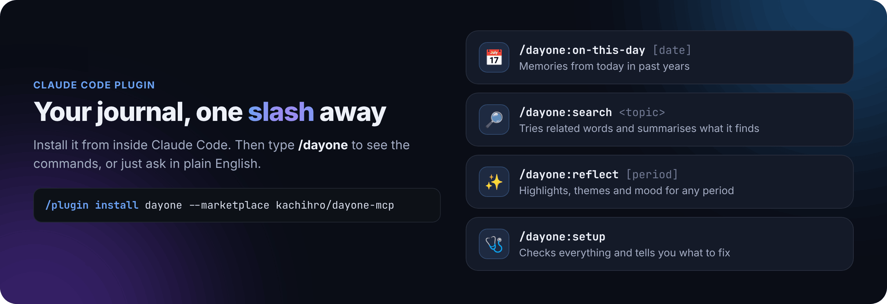

<p align="center"><a href="../README.md"></a></p>

# Manual setup

The [one-line installer](../README.md#-install) does all of this for you. Use this page if you'd rather
set things up by hand, or to connect an app the installer doesn't, such as VS Code or Cursor.

- [1. Set up the Day One CLI](#1-set-up-the-day-one-cli)
- [2. Get the server](#2-get-the-server)
- [Connect another app](#connect-another-app): Claude Desktop, VS Code, Claude Code, Cursor
- [The Claude Code plugin, by hand](#the-claude-code-plugin-by-hand)
- [The tools the AI can use](#the-tools-the-ai-can-use)

---

## 1. Set up the Day One CLI

Everything else needs Day One's official command-line tool.

1. Install [Node.js](https://nodejs.org) LTS, version 18 or newer (the Day One CLI needs it). On Windows
   you can run `winget install OpenJS.NodeJS.LTS`, then **close and reopen PowerShell**.
2. In PowerShell (Windows) or Terminal (Mac/Linux), run these one at a time:
   ```
   npm install -g @dayone/cli@latest
   dayone setup
   dayone sync
   ```
   `dayone setup` asks for your Day One email and password. `dayone sync` downloads your journals to your
   computer, and the first sync can take a few minutes.

   > **Windows tip:** the password prompt in `dayone setup` shows nothing and pasting can fail. This
   > signs in with a `*` prompt that accepts pasting:
   > ```powershell
   > $p = Read-Host 'Day One password' -AsSecureString
   > [System.Net.NetworkCredential]::new('', $p).Password | dayone auth login --email you@example.com --password-stdin | Out-Null
   > Remove-Variable p
   > ```
3. If your journals use **end-to-end encryption**, also run `dayone auth key-set`
   ([where to find your key](../README.md#-install)).
4. Check it worked: `dayone list journals` should list your journals.

## 2. Get the server

**Easiest:** run the [installer](../README.md#-install). It works even if you don't use Claude (it skips
the Claude steps). It puts the server here:

| | Server location |
|---|---|
| Windows | `%LOCALAPPDATA%\Programs\dayone-mcp\DayOneMcp.exe` (that's `C:\Users\<you>\AppData\Local\Programs\dayone-mcp\DayOneMcp.exe`) |
| macOS / Linux | `~/.local/share/dayone-mcp/DayOneMcp` |

**Or download it yourself** from the [latest release](https://github.com/kachihro/dayone-mcp/releases/latest):

| Computer | File |
|---|---|
| Windows | `dayone-mcp-win-x64.zip` |
| Mac with Apple silicon (M1 and later) | `dayone-mcp-osx-arm64.tar.gz` |
| Mac with Intel | `dayone-mcp-osx-x64.tar.gz` |
| Linux | `dayone-mcp-linux-x64.tar.gz` or `dayone-mcp-linux-arm64.tar.gz` |

1. Before extracting on **Windows:** right-click the zip → **Properties** → tick **Unblock** → **OK**.
   On a **Mac**, after extracting, run `xattr -d com.apple.quarantine /path/to/DayOneMcp` once.
2. Extract it somewhere permanent, then check it:
   - Windows (PowerShell, in that folder): `.\DayOneMcp.exe --check`
   - Mac/Linux (in that folder): `./DayOneMcp --check`

   It should say `OK: Day One CLI found, N journal(s) available`.

---

## Connect another app

In the examples, replace `YOU` / `you` with your user name (the folder name under `C:\Users` or
`/Users`), or use the path where you put the server.

### Claude Desktop

The installer does this for you, and restarts Claude Desktop so the change sticks.

**Windows shortcut:** download `dayone-mcp-win-x64.mcpb` from the
[latest release](https://github.com/kachihro/dayone-mcp/releases/latest) and double-click it to install it
as a Claude Desktop extension. You still need the [Day One CLI](#1-set-up-the-day-one-cli).

**By hand:** quit Claude Desktop fully first (it can undo changes made while it's open). Then open
`claude_desktop_config.json` (Claude Desktop: **Settings → Developer → Edit Config**) in a text editor such
as Notepad, and add the `dayone` entry:

```json
{
  "mcpServers": {
    "dayone": { "command": "C:\\Users\\YOU\\AppData\\Local\\Programs\\dayone-mcp\\DayOneMcp.exe" }
  }
}
```

- If the file already has an `"mcpServers"` section, add just the `"dayone": { ... }` line inside it,
  with a comma after the entry before it.
- In JSON, Windows paths need **double** backslashes (`\\`).
- Mac/Linux path: `"/Users/you/.local/share/dayone-mcp/DayOneMcp"`.

Save the file and reopen Claude Desktop. **dayone** should appear in **Settings → Plugins**.

### VS Code (GitHub Copilot)

Open the Command Palette (**Ctrl+Shift+P**, Mac: **Cmd+Shift+P**) and run **MCP: Add Server** →
**Command (stdio)**, then enter the server path. Or run **MCP: Open User Configuration** (all projects),
or create `.vscode/mcp.json` (one project), and add:

```json
{
  "servers": {
    "dayone": {
      "type": "stdio",
      "command": "C:\\Users\\YOU\\AppData\\Local\\Programs\\dayone-mcp\\DayOneMcp.exe"
    }
  }
}
```

Mac/Linux path: `"/Users/you/.local/share/dayone-mcp/DayOneMcp"`. Then open Copilot Chat in **Agent**
mode. If the tools don't appear, turn on `dayone` in the tools picker.

### Claude Code (without the plugin)

```
claude mcp add --scope user dayone -- "C:\Users\YOU\AppData\Local\Programs\dayone-mcp\DayOneMcp.exe"
```

### Cursor and other apps

Most apps use this format (Cursor: `~/.cursor/mcp.json`):

```json
{
  "mcpServers": {
    "dayone": { "command": "/Users/you/.local/share/dayone-mcp/DayOneMcp" }
  }
}
```

The server uses stdio and takes no arguments. You only need the optional `DAYONE_CLI_PATH` environment
variable if it can't find the Day One CLI (see [Troubleshooting](troubleshooting.md#setting-dayone_cli_path)).

---

## The Claude Code plugin, by hand

1. [Set up the Day One CLI](#1-set-up-the-day-one-cli).
2. In Claude Code, run:
   ```
   /plugin install dayone --marketplace kachihro/dayone-mcp
   ```
   <sub>On Claude Code older than 2.1.275 (check with `claude --version`), run
   `/plugin marketplace add kachihro/dayone-mcp` and then `/plugin install dayone@dayone-mcp` instead.</sub>
3. Start a new session and run **`/dayone:setup`** to check everything's working.

The plugin needs **Node.js 18 or newer**. The first time it starts, it downloads its server (about 40 MB)
and verifies the download. Update it with `claude plugin update dayone@dayone-mcp`, or `/plugin` in Claude Code.

<p align="center">
  <picture>
    <source media="(prefers-color-scheme: light)" srcset="images/plugin-light.png">
    
  </picture>
</p>

---

## The tools the AI can use

All read-only, apart from `sync_journals`, which only downloads your latest entries from Day One.

| Tool | What it does |
|---|---|
| `search_entries` | Search, filtered by date range, journal, tags, starred or media (photos, audio and so on) |
| `on_this_day` | Entries from today (or any date) in previous years |
| `list_journals` | Your journals |
| `list_entries` | Browse a journal, newest or oldest first |
| `read_entry` | Read one entry in full |
| `sync_journals` | Download your latest entries from Day One |

- Searches use the **copy of your journals on your computer**. Keep it up to date automatically with
  `dayone sync-schedule enable --interval-minutes 30`.
- **On Windows and Intel Macs, search is keyword-only**: it finds the words you use, not ones with similar
  meanings. On Apple silicon Macs and most Linux, the Day One CLI can also match by meaning.
- Dates use your computer's time zone, so an entry written at 11 pm stays on the right day.

---

[← Back to the README](../README.md)
